# RestoFlow — la commande en ligne pour votre restaurant

**RestoFlow est une plateforme de commande complète pour un restaurant.** Vos
clients consultent la carte sur leur téléphone, composent leur commande et
l'envoient au restaurant sur **WhatsApp**. Votre équipe gère la carte, les
offres, les commandes et les livreurs depuis un tableau de bord privé. Vos
livreurs ont leur propre application.

Le site est disponible en **français, arabe et anglais**, les prix sont en
dirhams (MAD) et le paiement se fait à la livraison ou au retrait, sans
paiement en ligne.

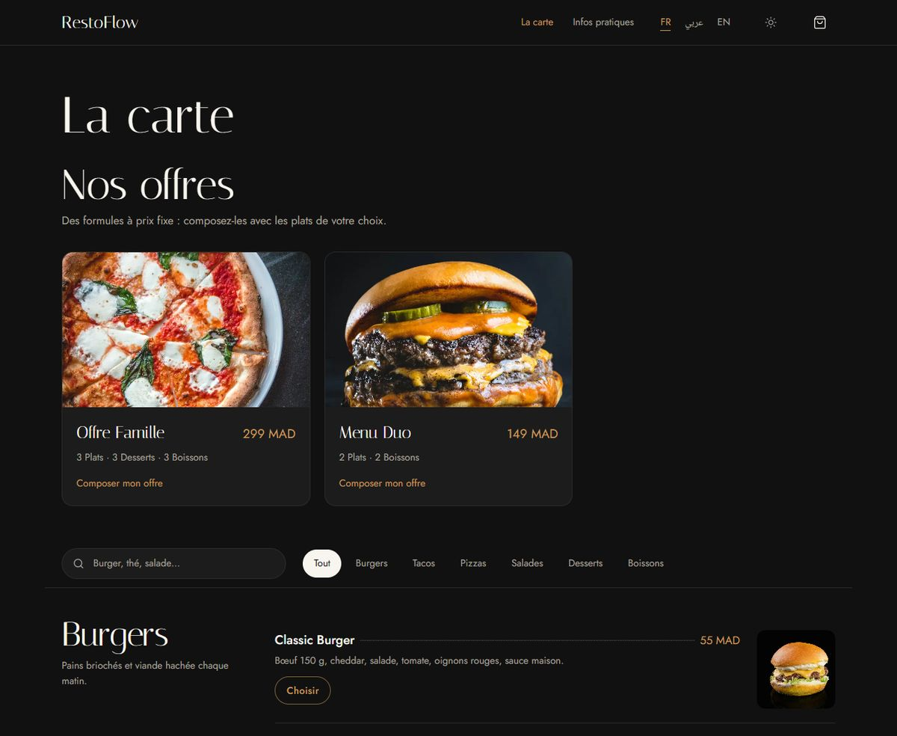

---

## Sommaire

1. [Pourquoi RestoFlow](#pourquoi-restoflow)
2. [Le parcours du client](#le-parcours-du-client)
3. [Les offres et packs](#les-offres-et-packs)
4. [Le tableau de bord du restaurant](#le-tableau-de-bord-du-restaurant)
5. [L'application livreur](#lapplication-livreur)
6. [Trois langues, mode clair et mode sombre](#trois-langues-mode-clair-et-mode-sombre)
7. [Fiabilité et sécurité](#fiabilité-et-sécurité)
8. [Sous le capot](#sous-le-capot)
9. [Essayer le projet](#essayer-le-projet)

---

## Pourquoi RestoFlow

| Pour le client | Pour le restaurant |
| --- | --- |
| Une carte claire, avec photos, prix et disponibilité du jour | Une seule carte à tenir à jour, visible partout immédiatement |
| Commander en quelques gestes, sans créer de compte | Chaque commande arrive sur WhatsApp, déjà détaillée et chiffrée |
| Le total exact, frais de livraison compris, avant d'envoyer | Les prix sont toujours recalculés par le serveur : aucune erreur de montant |
| Des offres à composer soi-même | Des promotions créées en quelques clics, avec dates de début et de fin |
| Le site dans sa langue, arabe compris | Un suivi des commandes, des livreurs et du chiffre d'affaires |

---

## Le parcours du client

1. **Il découvre la carte** : catégories, recherche, photos, plats du moment
   et offres en tête de carte.
2. **Il choisit ses plats** : format (taille), suppléments, remarques pour la
   cuisine (« sans oignons, bien cuit… »).
3. **Il vérifie son panier** : chaque article peut être modifié (format,
   suppléments, remarques) ou retiré, et le sous-total est confirmé par le
   serveur.
4. **Il passe la commande** : livraison (adresse et quartier) ou retrait sur
   place. Les frais de livraison, le minimum de commande et la livraison
   offerte s'affichent avant l'envoi.
5. **Il envoie sur WhatsApp** : la commande est enregistrée avec une
   référence (par exemple `RF-2026-0042`), puis WhatsApp s'ouvre avec le
   message prêt. **Le client appuie lui-même sur Envoyer**, et la commande
   n'est confirmée que par le restaurant.

| Composer son offre | Le panier |
| --- | --- |
| [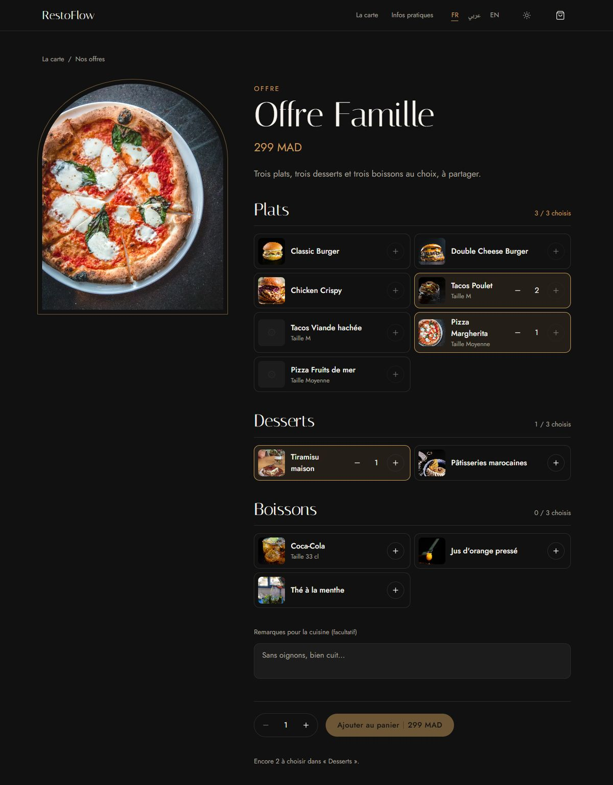](docs/screenshots/offer-builder.jpg) | [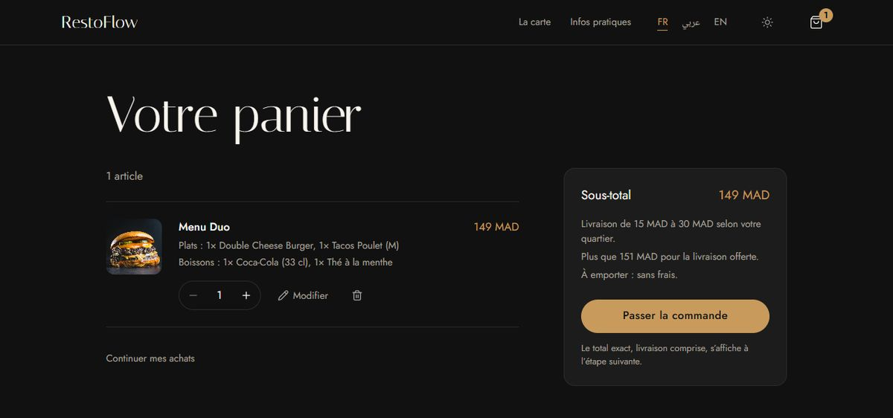](docs/screenshots/cart-offer.jpg) |

| Fiche produit | Validation de la commande | Envoi sur WhatsApp |
| --- | --- | --- |
| [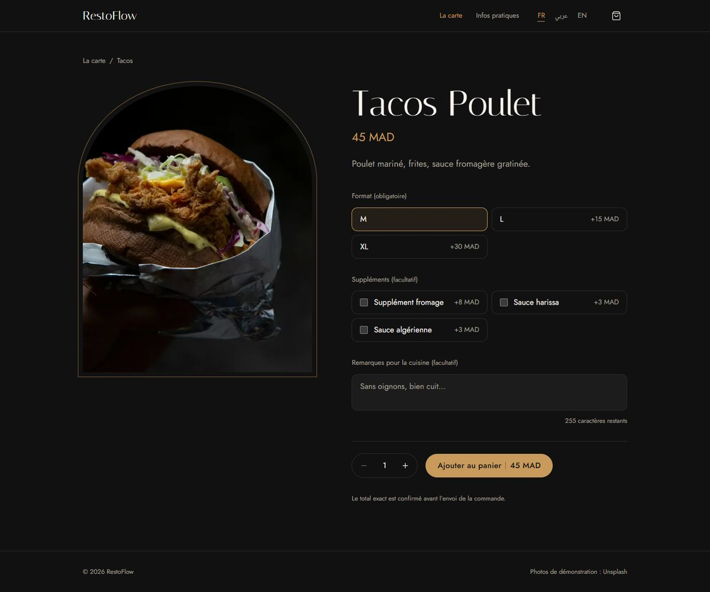](docs/screenshots/product.jpg) | [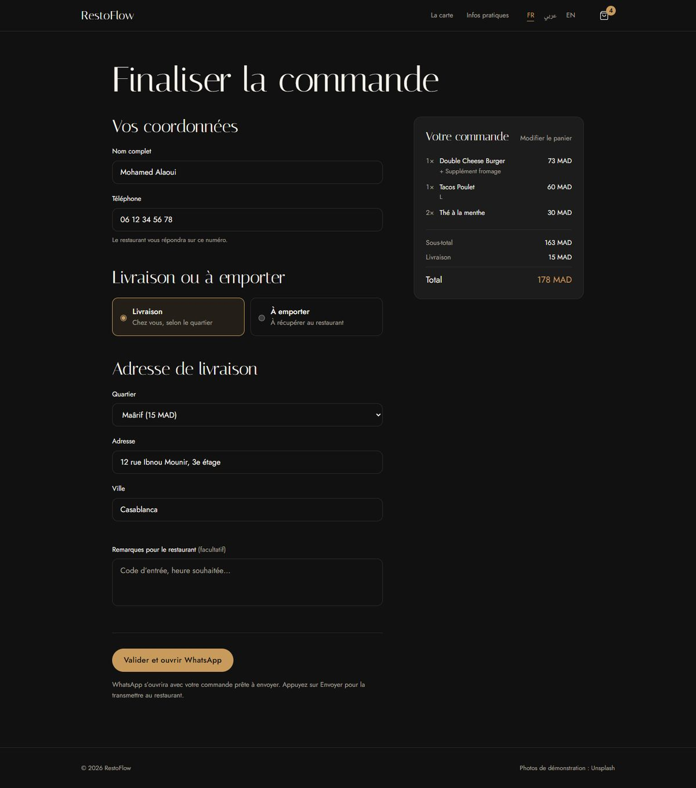](docs/screenshots/checkout.jpg) | [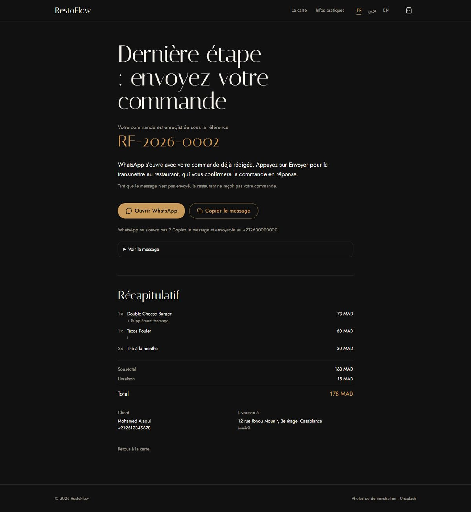](docs/screenshots/order.jpg) |

---

## Les offres et packs

Le restaurant crée des **formules à prix fixe** que le client compose
lui-même. Exemple : **Offre Famille à 500 MAD** :

- **3 plats** au choix parmi les tacos, pizzas et burgers ;
- **3 desserts** au choix ;
- **3 boissons** au choix.

**Côté restaurant**, chaque offre a :

- un nom et une description dans les trois langues, une image et un prix ;
- une période facultative (début et fin) pour les promotions limitées ;
- des **règles** : un groupe par choix à faire, le nombre de plats à choisir,
  et les plats autorisés, cochés catégorie par catégorie.

**Côté client**, l'offre se compose groupe par groupe avec un compteur
(« 2 / 3 choisis »). On peut prendre plusieurs fois le même plat, et l'ajout au
panier n'est possible qu'une fois l'offre complète.

Les plats choisis apparaissent sur le panier, la commande, le message
WhatsApp et l'application du livreur. Le serveur revérifie toutes les règles
et applique toujours le prix de l'offre.

| Les règles d'une offre, dans l'administration |
| --- |
| [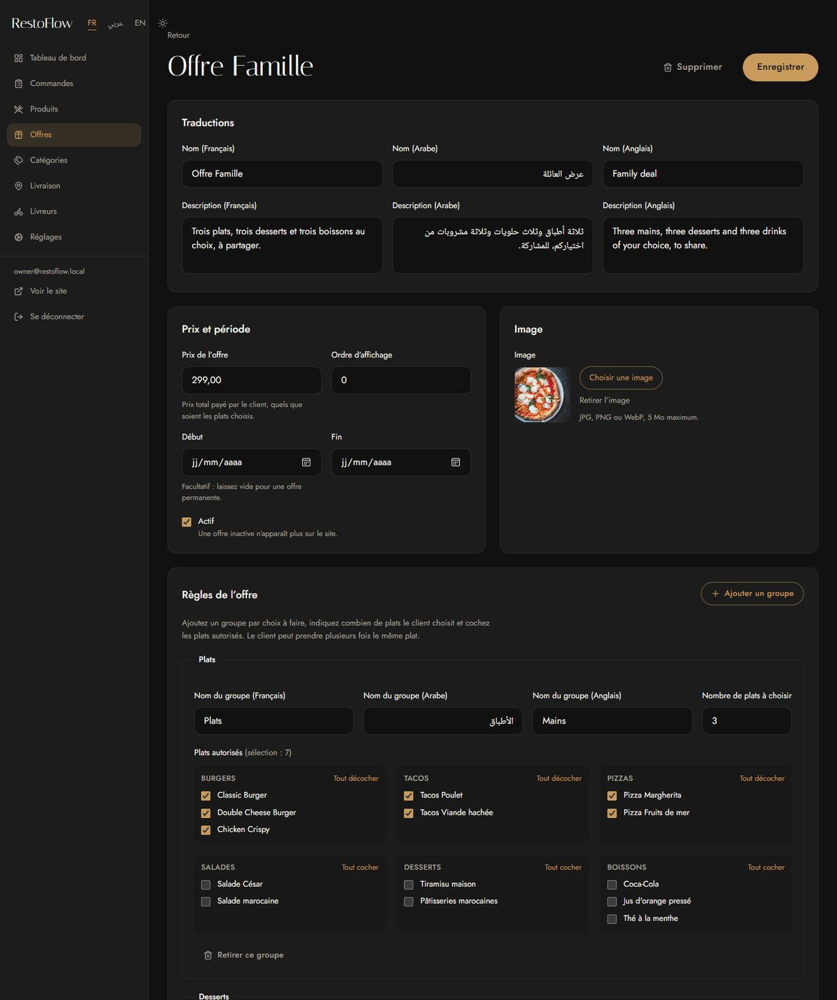](docs/screenshots/admin-offer-rules.jpg) |

---

## Le tableau de bord du restaurant

Accessible sur `/admin`, réservé à l'équipe (propriétaire et gérants).

| Section | Ce que l'équipe y fait |
| --- | --- |
| **Tableau de bord** | Commandes reçues et confirmées, chiffre d'affaires, plats les plus commandés, graphique par jour |
| **Commandes** | Recherche et filtres, détail complet, message WhatsApp reçu, changement de statut (confirmée, en préparation, en livraison, terminée…), affectation d'un livreur |
| **Produits** | Plats en trois langues, prix et prix promo, formats, suppléments, photos ; « disponible aujourd'hui » en un clic |
| **Offres** | Création des packs et de leurs règles |
| **Catégories, Livraison** | Ordre de la carte, quartiers livrés avec leurs frais et minimum de commande |
| **Livreurs** | Comptes livreurs, téléphone et quartiers desservis |
| **Réglages** | Coordonnées, numéro WhatsApp, horaires d'ouverture, livraison offerte, attribution automatique des livreurs (propriétaire uniquement) |

| Tableau de bord | Commande et affectation du livreur |
| --- | --- |
| [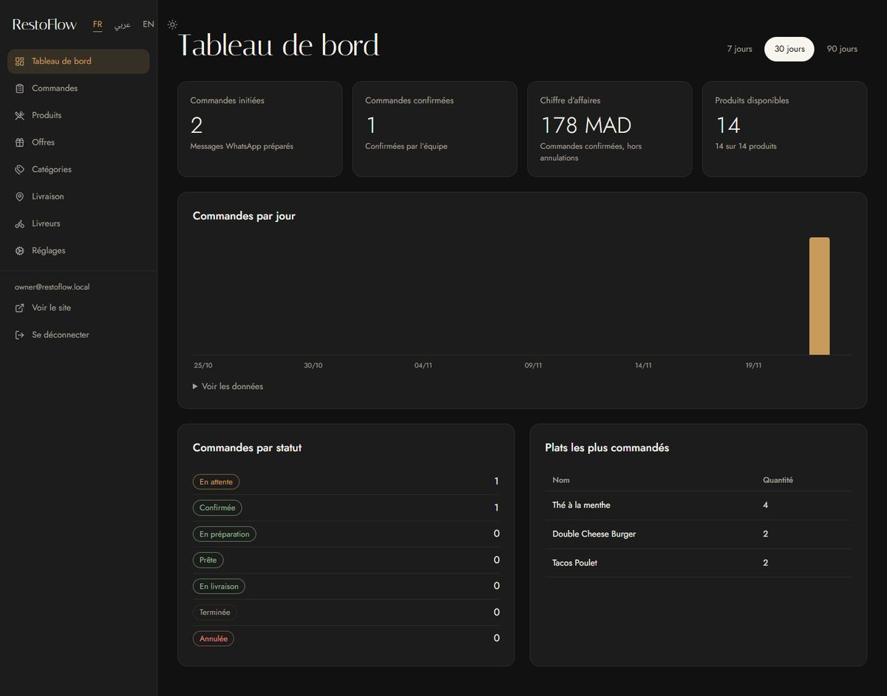](docs/screenshots/admin-dashboard.jpg) | [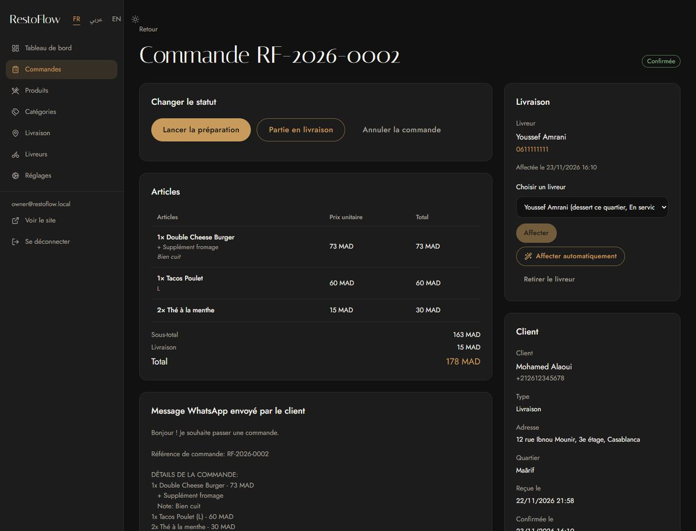](docs/screenshots/admin-courier-assignment.jpg) |

**Attribution des livraisons.** Une commande en livraison peut être confiée
à un livreur **à la main**, ou **automatiquement** dès sa confirmation : elle
va au livreur en service qui dessert le quartier et qui a le moins de
livraisons en cours.

---

## L'application livreur

Accessible sur `/livreur` depuis le téléphone, avec un compte livreur créé
dans l'administration. Le livreur ne voit **que ses livraisons**.

- un bouton **« En service »** pour recevoir des commandes ;
- la liste des livraisons à faire et déjà faites, mise à jour automatiquement ;
- pour chaque commande : client, adresse, articles, remarques et
  **montant à encaisser** ;
- boutons **Appeler**, **WhatsApp** et **Itinéraire** (Google Maps) ;
- **« J'ai récupéré la commande »** puis **« Commande livrée »** : le
  restaurant suit l'avancement en direct.

| Espace livreur | Une livraison |
| --- | --- |
| [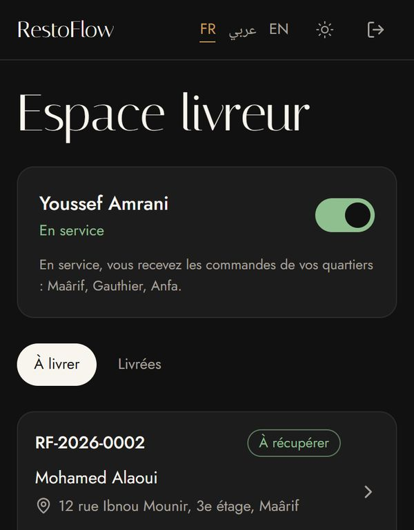](docs/screenshots/courier-app.jpg) | [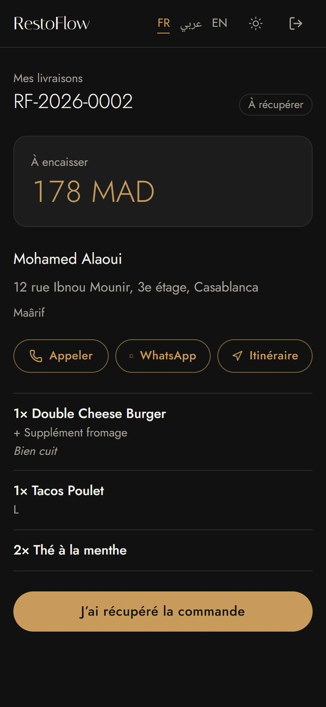](docs/screenshots/courier-delivery.jpg) |

---

## Trois langues, mode clair et mode sombre

- **Français** (par défaut), **arabe** avec une mise en page entièrement de
  droite à gauche, et **anglais**, sur le site, l'administration et
  l'application livreur.
- Les plats, catégories, offres et quartiers se saisissent dans les trois
  langues. Le message WhatsApp part dans la langue du client.
- **Mode sombre** (noir et laiton) ou **mode clair** (crème et bronze), en un
  clic, mémorisé sur l'appareil.

| Mode clair | Arabe, de droite à gauche (mobile) |
| --- | --- |
| [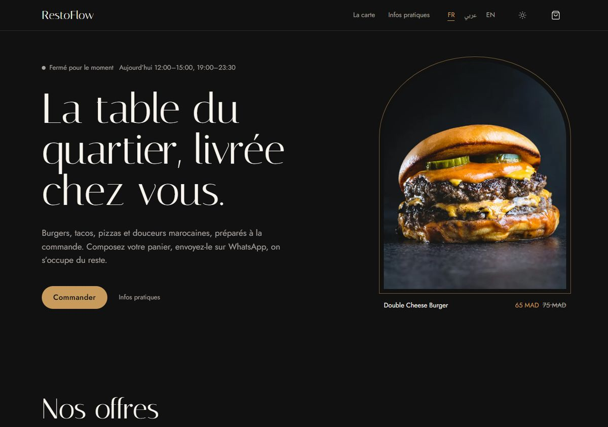](docs/screenshots/light-mode.jpg) | [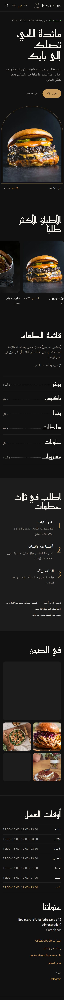](docs/screenshots/home-ar-mobile.jpg) |

---

## Fiabilité et sécurité

- **Les montants viennent toujours du serveur** : prix, suppléments, offres,
  frais de livraison et minimum de commande sont recalculés à chaque fois.
  Un prix modifié dans le navigateur est ignoré.
- **Pas de commande en double** : un client qui réessaie après une coupure
  réseau retrouve la même commande.
- **Historique fidèle** : chaque commande garde les noms et les prix du
  moment, même si la carte change ensuite.
- **Jamais de confirmation automatique** : une commande WhatsApp reste « en
  attente » jusqu'à ce que le restaurant la confirme.
- **Accès protégés** : connexion sécurisée, rôles distincts (propriétaire,
  gérant, livreur), limitation des tentatives de connexion, contrôle des
  images envoyées. Toutes les vérifications sont faites côté serveur.
- **Accessibilité et référencement** : navigation au clavier, lecteurs
  d'écran, contrastes vérifiés, pages optimisées pour Google (sitemap,
  balises, données structurées du restaurant).
- **Testé** : plus de 350 tests automatiques (225 côté serveur, 135 côté
  site), dont des contrôles d'accessibilité en français et en arabe.

---

## Sous le capot

| Partie | Technologies |
| --- | --- |
| Serveur et API | Python, Django, Django REST Framework, PostgreSQL |
| Site, administration, application livreur | React, TypeScript, Vite, Tailwind CSS, TanStack Query, Zustand, i18next |
| Mise en production | Docker, Gunicorn, Nginx, HTTPS |
| Qualité | pytest, Vitest, Testing Library, axe-core, Ruff, ESLint, Prettier |

Documentation technique :

- [README](README.md) : installation, configuration, tests ;
- [Architecture](docs/architecture.md) ;
- [Base de données](docs/database.md) ;
- [API](docs/api.md) ;
- [Mise en production](docs/deployment.md).

---

## Essayer le projet

Le [README](README.md#getting-started) décrit l'installation pas à pas
(Docker pour la base de données, Django, puis le site). La commande
`python manage.py seed_demo` charge une carte de démonstration complète :

- 14 plats avec photos ;
- 2 offres (« Offre Famille » et « Menu Duo ») ;
- 6 quartiers de Casablanca ;
- 2 livreurs de démo.

Toutes ces données sont fictives et réservées au développement.

| Adresse | Pour qui |
| --- | --- |
| `/` | Les clients : le site et la carte |
| `/admin` | L'équipe du restaurant |
| `/livreur` | Les livreurs |
