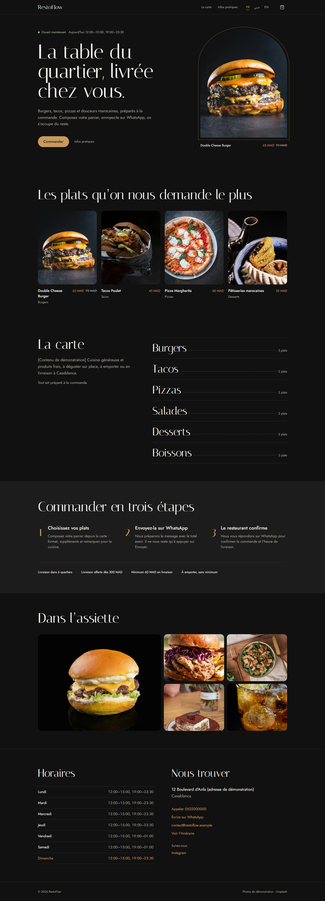
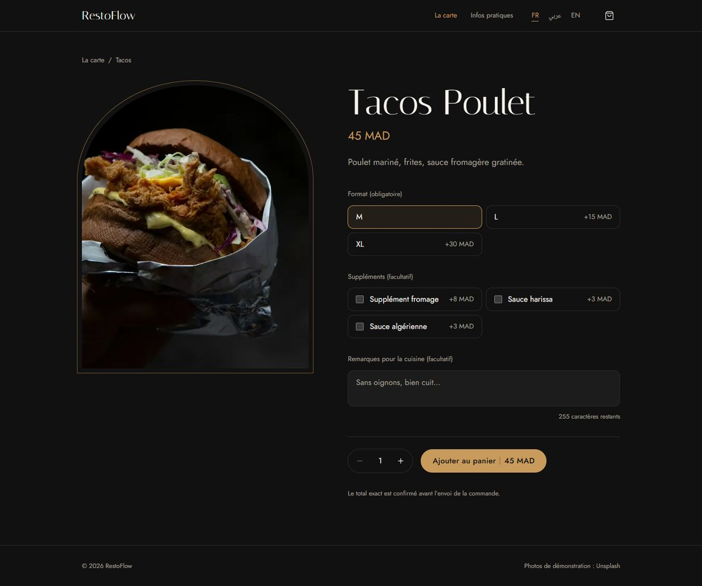
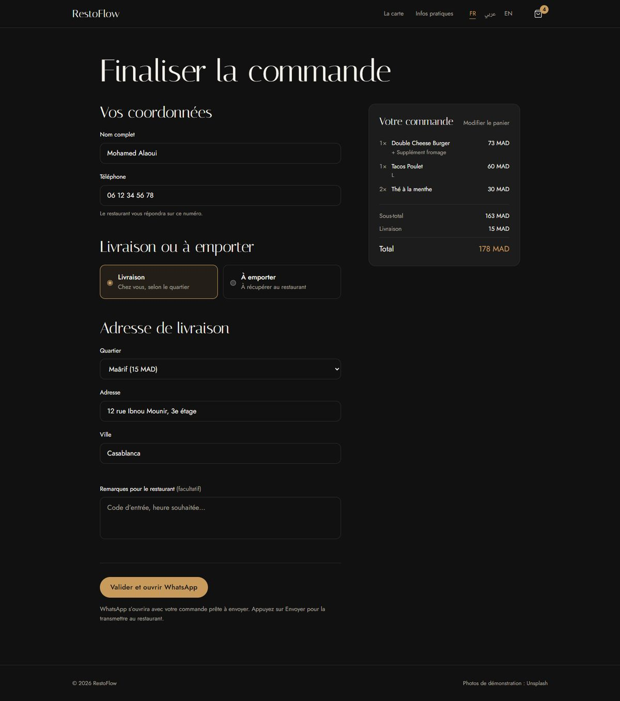
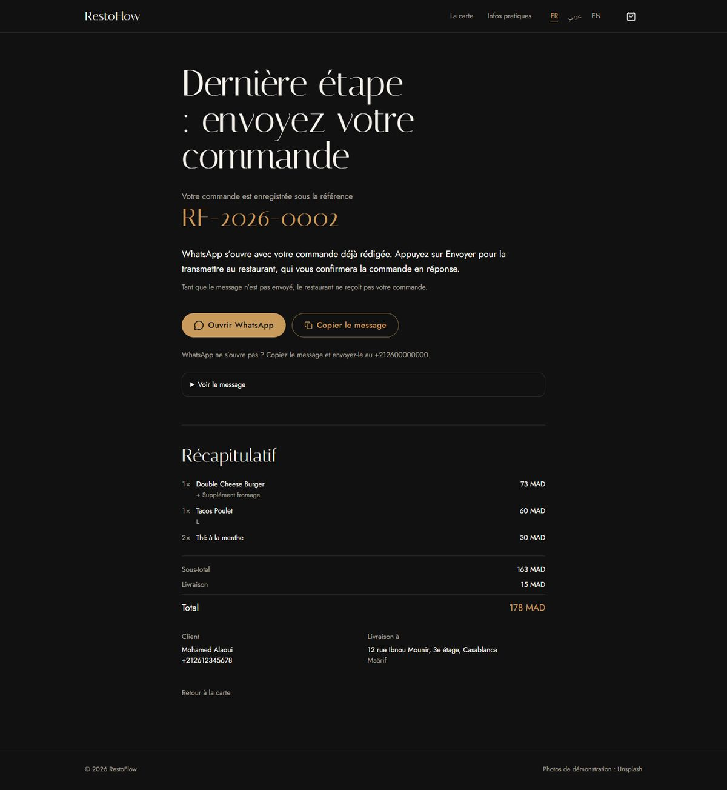
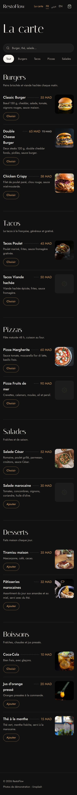
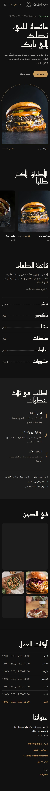

# RestoFlow

**A full-stack ordering platform for a single restaurant.** Customers browse a
multilingual menu (French, Arabic, English), build a cart and check out. Each
order is validated and saved by the backend, then handed off to WhatsApp, where
the customer sends it to the restaurant. Staff manage the catalog, delivery
zones, settings and orders from a private dashboard.

Prices are in Moroccan dirhams (MAD). There is no online payment: orders are
paid on delivery or pickup.

> 🇫🇷 **Présentation de l'application (en français) : [PRESENTATION.md](PRESENTATION.md)**

> **Project status: complete (all 7 phases).** Customers browse the menu,
> order and send their order on WhatsApp; the team runs the restaurant from
> `/admin`; everything works in French, Arabic (right-to-left) and English,
> and ships as a tested, documented Docker stack.

---

## Features

| Area | Highlights | Status |
| --- | --- | --- |
| Public site | Homepage, menu with category filters and search, product detail with variants and add-ons | ✅ |
| Ordering | Cart with server-checked totals and editable lines (size, extras, notes), checkout with validation, delivery zones, fees and minimums, order snapshots, WhatsApp hand-off with retry | ✅ |
| Administration | Staff login, dashboard (orders, confirmed revenue, popular dishes, daily chart), orders with manual status workflow, products with sizes, extras and photos, categories, delivery zones, restaurant settings and opening hours | ✅ |
| Offers | Fixed-price packs built by the customer (e.g. 3 mains + 3 desserts + 3 drinks chosen from dishes the restaurant allows), optional promotion dates, managed in Admin → Offers | ✅ |
| Delivery | Courier accounts and a mobile courier app (`/livreur`): on-duty switch, assigned deliveries, call / WhatsApp / directions, pick-up and delivery; staff assign a courier by hand or automatically by delivery zone | ✅ |
| Multilingual | French (default), Arabic with full RTL layout, English; translated catalog content | ✅ |
| API | REST, OpenAPI/Swagger docs, pagination, filtering, search, consistent error codes | ✅ |
| Security | Session auth + CSRF, deny-by-default permissions, owner/manager roles, rate limiting, upload validation, DB constraints | ✅ · reviewed again in Phase 6 |

## Tech stack

| Layer | Technologies |
| --- | --- |
| Frontend | React 19, TypeScript (strict), Vite, Tailwind CSS v4, React Router, TanStack Query, Zustand, i18next, Lucide |
| Backend | Python, Django 5.2 LTS, Django REST Framework, django-filter, drf-spectacular, Pillow |
| Database | PostgreSQL 17 |
| Testing | Pytest + pytest-django, Vitest + React Testing Library |
| Quality | Ruff, ESLint, Prettier, TypeScript strict mode |

## Architecture

```
React SPA ──/api (JSON, session cookie + CSRF)──▶ Django REST API ──▶ PostgreSQL
    │
    └── wa.me link with the server-built order message ──▶ WhatsApp (customer presses Send)
```

- The backend is the single source of truth for prices, totals and order
  references. The client sends only product IDs, options and quantities.
- Orders are saved **before** WhatsApp opens. They are never marked confirmed
  automatically: staff confirm them by hand.

Details: [docs/architecture.md](docs/architecture.md).

## Screenshots

Taken from the running app with the demo data (`seed_demo`).

| Homepage | Product | Checkout |
| --- | --- | --- |
| [](docs/screenshots/home.jpg) | [](docs/screenshots/product.jpg) | [](docs/screenshots/checkout.jpg) |

| WhatsApp hand-off | Menu (mobile) | Arabic, right-to-left (mobile) |
| --- | --- | --- |
| [](docs/screenshots/order.jpg) | [](docs/screenshots/menu-mobile.jpg) | [](docs/screenshots/home-ar-mobile.jpg) |

## Design

Casablanca Art Deco on the brand's black and brass palette: Italiana and Jost
for Latin text, Reem Kufi and Noto Naskh for Arabic, food photography framed
in a Moroccan arch, and a menu laid out like a printed menu card. A light
mode (cream and bronze) is one tap away in the header and remembered. See
[docs/architecture.md](docs/architecture.md#5b-design-system).

---

## Getting started

### Prerequisites

| Tool | Version |
| --- | --- |
| Python | 3.12 or newer (developed on 3.14) |
| Node.js | 22.12 or newer (developed on 24) |
| Docker | Docker Desktop or Docker Engine with Compose v2 (for PostgreSQL) |

You can use a native PostgreSQL install instead of Docker: just point the
`POSTGRES_*` variables at it.

### 1. Configure the environment

```bash
cp .env.example .env
```

Then edit `.env`:

- `DJANGO_SECRET_KEY`: generate one with
  `python -c "import secrets; print(secrets.token_urlsafe(64))"`
- `POSTGRES_PASSWORD`: any local password

`.env` is git-ignored. Never commit it.

### 2. Start PostgreSQL

```bash
docker compose up -d db
```

### 3. Backend

```bash
cd backend
python -m venv .venv

# Windows (PowerShell)
.venv\Scripts\Activate.ps1
# macOS / Linux
source .venv/bin/activate

pip install -r requirements-dev.txt
python manage.py migrate
python manage.py createsuperuser      # email + password (gets the owner role)
python manage.py seed_demo            # optional: demo menu with photos, zones and hours
python manage.py runserver            # http://127.0.0.1:8000
```

### 4. Frontend

In a second terminal:

```bash
cd frontend
npm install
npm run dev                           # http://localhost:5173
```

Open <http://localhost:5173>. The home page shows a live **System status**
card that confirms the SPA can reach the API and the database.

### Useful URLs (development)

| URL | Purpose |
| --- | --- |
| http://localhost:5173 | React app (proxies `/api` and `/media` to Django) |
| http://localhost:5173/admin | Administration dashboard (log in with a staff account, e.g. the one from `createsuperuser`) |
| http://localhost:5173/livreur | Courier app (log in with a courier account created in Admin → Couriers, or a demo courier from `seed_demo`) |
| http://127.0.0.1:8000/api/health/ | Health check |
| http://127.0.0.1:8000/api/docs/ | Swagger UI |
| http://127.0.0.1:8000/api/schema/ | OpenAPI 3 schema |
| http://127.0.0.1:8000/django-admin/ | Django admin (the React dashboard owns `/admin`) |

### Ports already in use?

Run Django on another port and point the Vite proxy at it:

```bash
python manage.py runserver 127.0.0.1:8010
# in frontend/ (bash syntax; in PowerShell set $env:VITE_DEV_API_PROXY_TARGET first)
VITE_DEV_API_PROXY_TARGET=http://127.0.0.1:8010 npm run dev -- --port 5180
```

You can also set `VITE_DEV_API_PROXY_TARGET` in `.env`. If you change the
frontend origin, update `CORS_ALLOWED_ORIGINS` / `CSRF_TRUSTED_ORIGINS` to
match.

## Environment variables

All variables live in the root `.env` (template: [.env.example](.env.example)).

| Variable | Used by | Description |
| --- | --- | --- |
| `DJANGO_SECRET_KEY` | Django | Secret signing key (required) |
| `DJANGO_DEBUG` | Django | `True` in development only |
| `DJANGO_ALLOWED_HOSTS` | Django | Comma-separated host names |
| `DJANGO_ADMIN_URL` | Django | Path of the built-in Django admin (default `django-admin/`) |
| `CORS_ALLOWED_ORIGINS` / `CSRF_TRUSTED_ORIGINS` | Django | Allowed frontend origins when not same-origin |
| `POSTGRES_DB`, `POSTGRES_USER`, `POSTGRES_PASSWORD`, `POSTGRES_HOST`, `POSTGRES_PORT` | Django, Docker | Database connection |
| `ORDER_REFERENCE_PREFIX` | Django | Prefix of order references (default `RF`, e.g. `RF-2026-0001`) |
| `THROTTLE_ANON`, `THROTTLE_ORDERS`, `THROTTLE_LOGIN` | Django | Rate limits (defaults `120/minute`, `10/minute`, `5/minute`) |
| `MAX_IMAGE_UPLOAD_SIZE` | Django | Maximum upload size in bytes (default 4 MB, under Vercel’s 4.5 MB request limit) |
| `PUBLIC_SITE_URL` | Django | Public address of the site, used for absolute URLs in `sitemap.xml` and `robots.txt` |
| `DATABASE_URL` | Django | Optional; overrides the `POSTGRES_*` values |
| `DB_CONN_MAX_AGE` | Django | Seconds to keep database connections open: 60 in production, 0 in development (the dev server uses a new thread, hence a new connection, per request) |
| `VITE_API_BASE_URL` | Frontend | API base path or URL (default `/api`) |
| `VITE_DEV_API_PROXY_TARGET` | Vite dev server | Django address for the dev proxy |

Only `VITE_*` variables reach the browser bundle. Never put secrets in them.

> **Windows note:** keep `POSTGRES_HOST=127.0.0.1`. On Windows `localhost`
> resolves to IPv6 `::1` first, while Docker publishes the port on IPv4 only,
> and every connection stalls.

## Testing and code quality

| Suite | Coverage |
| --- | --- |
| Backend, pytest (225 tests) | Offers (rules, pricing, choices, snapshots, WhatsApp), couriers and dispatch (manual and automatic assignment, pick-up, delivery, access rules), models and database constraints, pricing (variants, add-ons, sale prices, delivery fees, free delivery, minimum order), order creation and snapshots, idempotent retries, WhatsApp message, status workflow, authentication, permissions (anonymous, customer, manager, owner), uploads, rate limiting, dashboard, sitemap |
| Frontend, Vitest + Testing Library (135 tests) | Money and pricing helpers, cart store and line editing, offers (building, cart, editing, admin rules), light/dark theme, courier app, i18n (keys, plurals, RTL), menu, product options, cart quotes, checkout validation and error mapping, WhatsApp URLs and hand-off (desktop and phone), order page, admin flows, and axe-core accessibility checks on six pages in French and Arabic |

```bash
# Backend (needs the PostgreSQL container running)
cd backend
pytest                       # test suite
ruff check . && ruff format --check .

# Frontend
cd frontend
npm test                     # Vitest + React Testing Library
npm run typecheck            # tsc, strict
npm run lint                 # ESLint
npm run format:check         # Prettier
npm run build                # production build
```

## Project structure

```
restoflow/
├── backend/            Django project (config/, apps/, tests/)
├── frontend/           React + TypeScript SPA (src/…)
├── docs/               Architecture and project documentation
├── docker-compose.yml  Local PostgreSQL
└── .env.example        Environment template (placeholders only)
```

## Documentation

- [Architecture](docs/architecture.md): components, data flow, key decisions
- [Database](docs/database.md): schema, relationships, constraints, demo data
- [API reference](docs/api.md): conventions, error codes, order flow, admin endpoints (interactive docs at `/api/docs/`)
- [Deployment](docs/deployment.md): production stack, HTTPS, operations, backups, checklist

## Roadmap

1. ✅ **Foundation:** project structure, Django and React configuration, PostgreSQL, tooling, docs
2. ✅ **Backend:** models and migrations, serializers, public and admin APIs, authentication, tests
3. ✅ **Frontend:** design system, homepage, menu, product detail, cart store, i18n content
4. ✅ **Ordering:** cart, checkout, server-side price validation, order creation, WhatsApp hand-off
5. ✅ **Admin:** login, dashboard, product, category, order and settings management
6. ✅ **Quality:** full test pass, security hardening, performance, documentation
7. ✅ **Deployment:** production settings, static and media files, build, deployment guide

## Security

- Staff authentication with Django sessions (HttpOnly cookie) and CSRF
  protection, including on the login view; login is rate limited.
- Deny-by-default API permissions; staff-only admin endpoints; owner-only
  restaurant settings. Customers never have accounts.
- Prices are always recomputed server-side; clients send identifiers only.
- Input validation on every endpoint, database `CHECK` constraints on money
  and quantities, upload validation (type, size, dimensions, Pillow decoding,
  random file names).
- Rate limits on order creation and login, counted in a cache shared by all
  production workers.
- Production settings enforce HTTPS redirects, HSTS, secure cookies and a
  strong secret key; `manage.py check --deploy` passes (HSTS preload is opt-in).
- Dependency audits: `npm audit` and `pip-audit` report no known
  vulnerabilities.

## Deployment

Production runs as three containers: PostgreSQL, Django behind Gunicorn, and
nginx serving the React build with security headers and proxying the API.

```bash
cp .env.production.example .env.production   # fill every placeholder
docker compose -f docker-compose.prod.yml --env-file .env.production up -d --build
docker compose -f docker-compose.prod.yml --env-file .env.production exec backend python manage.py createsuperuser
```

**Serverless alternative: Vercel + Supabase.** The repository also deploys as
a single Vercel project (`vercel.json`, `api/index.py`): the React build is
static, Django runs as a Python function, the database is Supabase
PostgreSQL and uploaded photos go to Supabase Storage. See
[docs/deployment.md, section 8b](docs/deployment.md#8b-vercel--supabase-serverless).

Put a TLS proxy in front (e.g. Caddy). The full guide covers HTTPS, backups,
updates, hosting without Docker and a pre-launch checklist:
[docs/deployment.md](docs/deployment.md).
