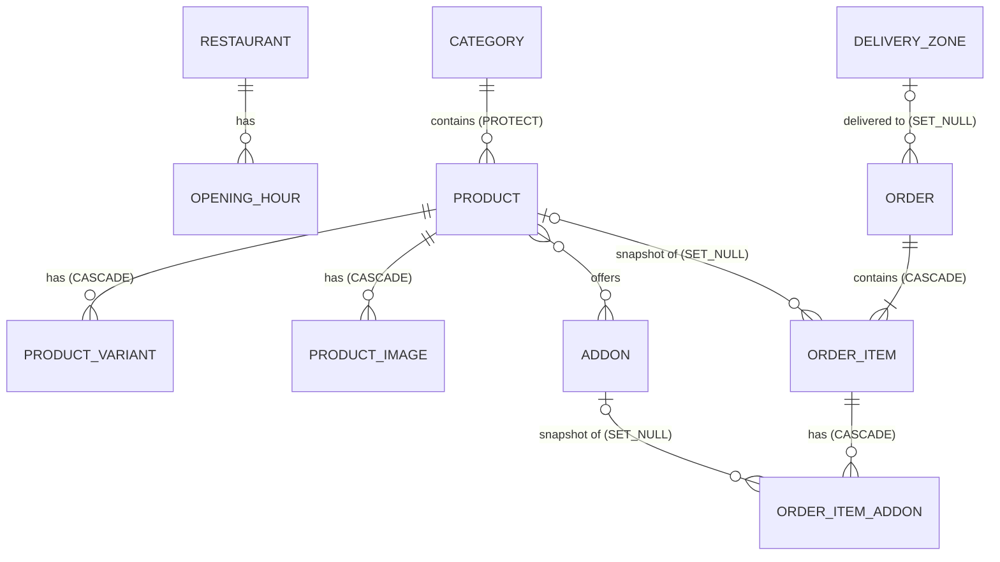

# RestoFlow — Database

PostgreSQL 17. All tables come from Django migrations (`backend/apps/*/migrations`).

## Conventions

- **Money:** `NUMERIC(10, 2)` (`DecimalField`), handled as `Decimal` in Python
  and serialised as strings in JSON. Floats are never used for prices.
- **Translations:** one column per language (`name_fr`, `name_ar`,
  `name_en`). French is required; Arabic and English fall back to French when
  empty. The API returns the value for the request's `Accept-Language`.
- **Timestamps:** `created_at` and `updated_at` on most tables, stored in UTC
  and displayed in `Africa/Casablanca`.
- **Deletion:** nothing in the catalog cascades into orders. Order lines
  reference products with `SET_NULL` and keep their own snapshots.
- **Integrity in the database:** business invariants are `CHECK`
  constraints, so they hold even for writes that bypass Django validation.

## Entity relationships

## Tables

### accounts_user
Staff accounts. Customers never have accounts.

| Column | Type | Notes |
| --- | --- | --- |
| email | varchar, unique | login identifier, stored lower-case; plus a unique index on `LOWER(email)` |
| password | varchar | PBKDF2 hash (Django default) |
| role | `owner` / `manager` | the owner (or a superuser) manages restaurant settings |
| is_staff, is_active, is_superuser | bool | only active staff can use the dashboard |

### restaurant_restaurant (single row)
| Column | Notes |
| --- | --- |
| singleton | always 1; `UNIQUE` + `CHECK (singleton = 1)` guarantee a single row |
| name, logo, description_fr/ar/en | identity |
| address, city, phone, email | contact |
| whatsapp_number | international digits only, e.g. `212612345678` (validated and normalised) |
| currency | `MAD` |
| facebook_url, instagram_url, tiktok_url, google_maps_url | social links |
| is_accepting_orders, delivery_enabled, pickup_enabled | ordering switches |
| minimum_order_amount | minimum subtotal for **delivery** (≥ 0) |
| free_delivery_threshold | nullable; delivery is free at or above this subtotal |

### restaurant_openinghour
| Column | Notes |
| --- | --- |
| restaurant_id | FK, CASCADE |
| weekday | 0 = Monday … 6 = Sunday |
| opens_at, closes_at | nullable times; `closes_at < opens_at` means the slot runs past midnight |
| is_closed | when false, both times are required and must differ (`CHECK`) |

Several slots per day are allowed (lunch and dinner), with `UNIQUE (restaurant, weekday, opens_at)`.

### categories_category
`name_*`, `slug` (unique, generated from `name_fr`), `description_*`, `image`,
`display_order`, `is_active`. Index: `(is_active, display_order)`.

### products_product
| Column | Notes |
| --- | --- |
| category_id | FK, **PROTECT**: a category with products cannot be deleted |
| name_*, slug, description_* | translated content |
| price | `CHECK (price > 0)` |
| sale_price | nullable; `CHECK (sale_price >= 0 AND sale_price < price)` |
| image | main image |
| is_active | hidden from the menu when false |
| is_available | still shown, but marked unavailable (e.g. sold out) |
| is_featured, display_order | merchandising |

Indexes: `(category, is_active, display_order)`, `(is_active, is_featured)`.

### products_productvariant
Mutually exclusive option (such as a size): `name_*`, `price_delta ≥ 0`,
`display_order`, `is_active`, with `UNIQUE (product, name_fr)`. If a product has
active variants, the customer must choose exactly one.

### products_addon and products_product_addons
Optional extras shared between products: `name_*`, `price ≥ 0`, `is_active`.
The M2M table lists which add-ons each product offers.

### products_productimage
Gallery images (`product_id` CASCADE, `image`, `display_order`).

### delivery_deliveryzone
`name_*` (`name_fr` unique), `delivery_fee ≥ 0`, `minimum_order_amount ≥ 0`,
`display_order`, `is_active`.

### orders_order
| Column | Notes |
| --- | --- |
| reference | unique, `RF-<year>-<4-digit sequence>` |
| status | `pending` → `confirmed` → `preparing` → `ready` / `out_for_delivery` → `completed`, or `cancelled` |
| order_type | `delivery` / `pickup` |
| customer_name, customer_phone | phone normalised to `+<digits>` |
| delivery_address, city | address is empty for pickup |
| delivery_zone_id | FK SET_NULL; `delivery_zone_name` keeps a snapshot |
| customer_notes, language | `language` is the customer's language (used for snapshots and the WhatsApp message) |
| subtotal, delivery_fee, total, currency | authoritative amounts |
| whatsapp_number, whatsapp_message | exact hand-off data, so a retry sends the same message |
| confirmed_at | set the first time staff confirm the order |

Constraints: `total = subtotal + delivery_fee`; amounts ≥ 0; pickup orders
have `delivery_fee = 0`. Indexes: `(status, created_at)`, `created_at`,
`customer_phone`.

### orders_orderitem
| Column | Notes |
| --- | --- |
| product_id | FK SET_NULL (informational only) |
| product_name, product_price | snapshot (effective price, i.e. the sale price if any) |
| variant_name, variant_price | snapshot |
| quantity | `CHECK (quantity >= 1)` |
| unit_price | product + variant + add-ons, for one unit |
| line_total | `CHECK (line_total = unit_price * quantity)` |
| special_instructions | free text (255) |

### orders_orderitemaddon
`order_item_id` (CASCADE), `addon_id` (SET_NULL), `addon_name` and
`addon_price` snapshots.

### orders_ordersequence
`year` (PK) and `last_value`. Reference generation locks the year's row
(`SELECT … FOR UPDATE`) inside the order transaction, so concurrent orders
never share a number.

## Demo data

`python manage.py seed_demo` loads **fictional demo content**: 6 categories,
14 products with variants and add-ons, 6 Casablanca delivery zones, and
opening hours. It is idempotent and refuses to run when `DEBUG` is off
(unless `--force`). The WhatsApp number is a placeholder (`212600000000`).
